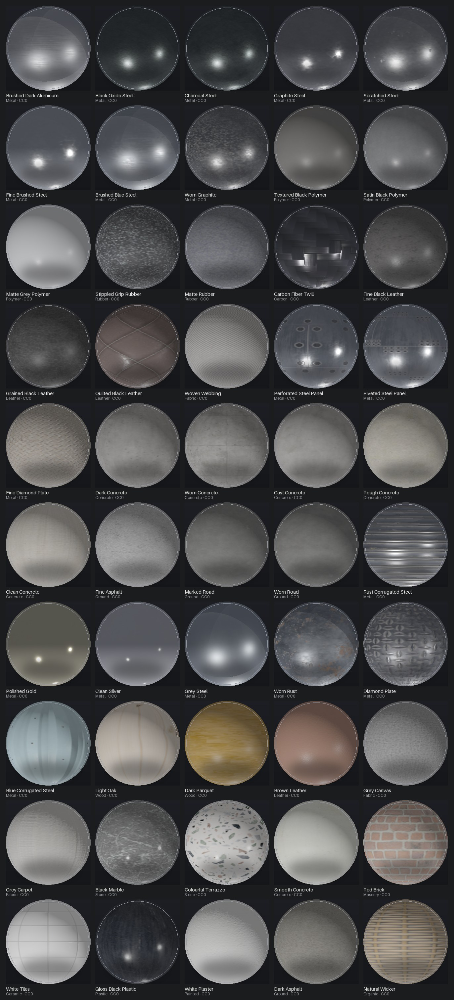
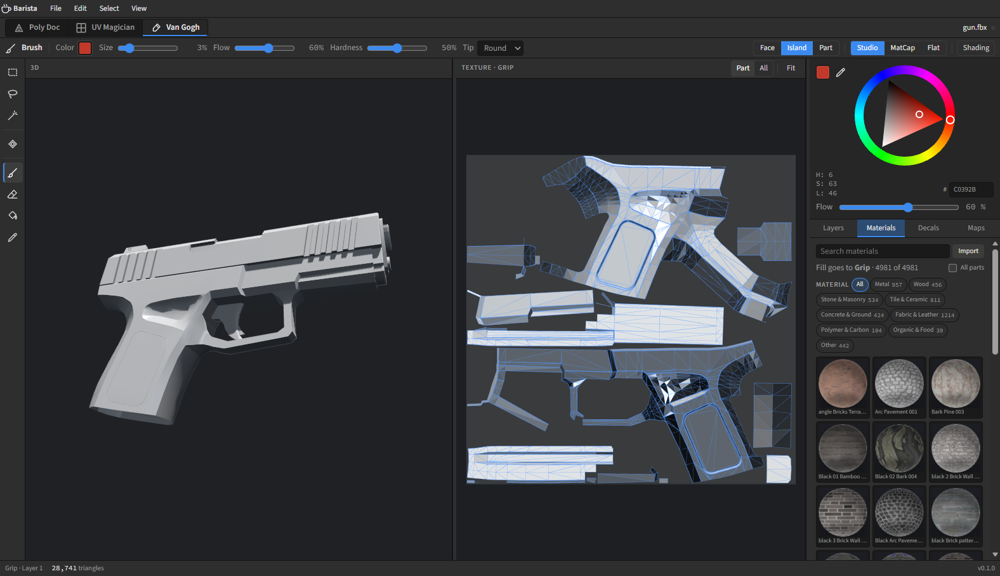
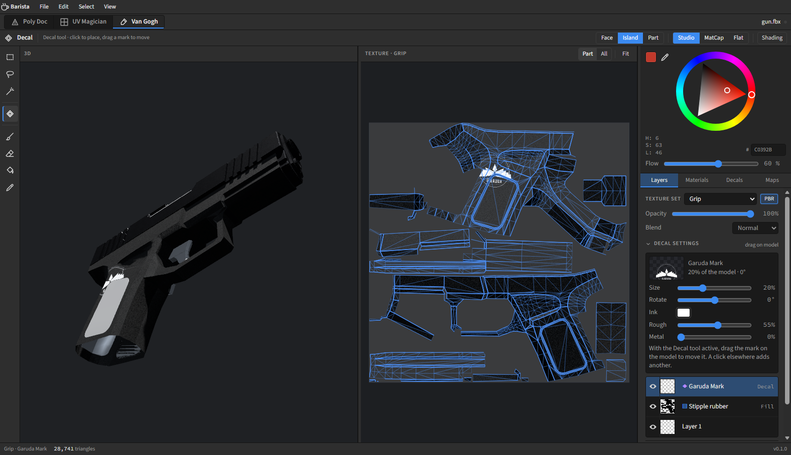
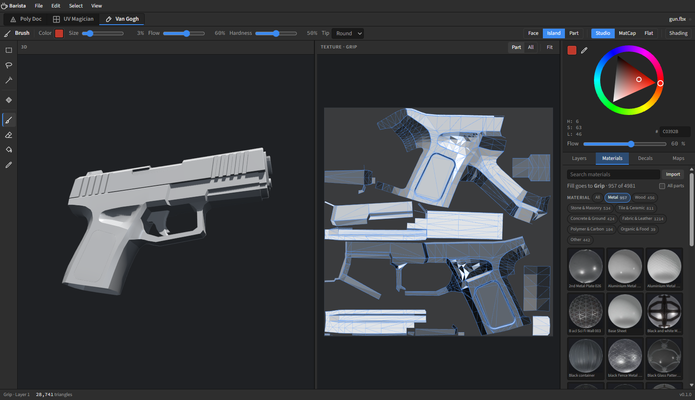
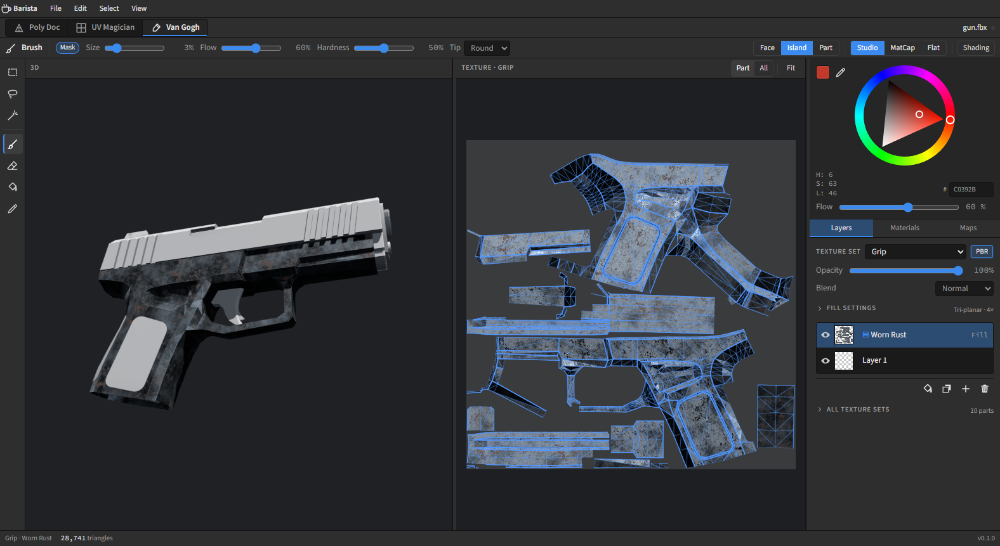
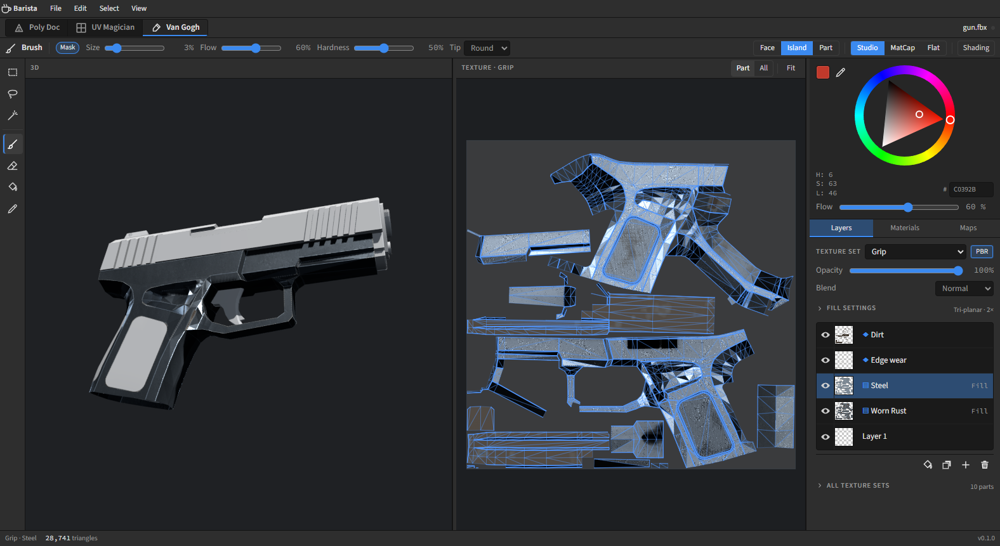

# PBR materials in Van Gogh

**Status:** P1 and P2 are implemented — a game-first material library, fill layers, UV/tri-planar
projection, normal and height channels, mask painting, folder import, layer blend modes, all-parts
assignment and game-engine texture presets. The Materials panel is deliberately category-only: role and
smart-finish rows were removed; `smartmaterials.ts` remains as data for later use. **Decals** ship as projected layers
with their own shelf, import, drag-to-move, size/rotation/tint/roughness/metallic settings. The local
**purchased PBR Asset Browser V3 pack** is now the material shelf itself: 4,981 materials, nine
Material categories, paged grid, 1K browser cache from 2K sources; git-ignored and never bundled. The
small CC0 core set remains only as a fallback if the pack is absent. Color is a permanent
section above the **Layers / Materials / Decals / Maps** tabs; baking is active-part by default and
chunked so it no longer freezes the editor. Brushes have round / square / chalk / spray / ring tips
and follow pen pressure. P3 (worker/4K, more projections, parallax) and the P4 Substance bridge are
still open. The “what shipped” sections at the end of §8 list the exact scope; painting and bake
timings are in [van-gogh-performance.md](van-gogh-performance.md).



---

## 0. The short version

- Van Gogh already paints a **metallic/roughness PBR material**: Base Color, Roughness, Metallic,
  with the baked AO shown separately. What is missing is **normal/height**, a **material asset**
  (a set of maps you can assign), and the **fill layer** that projects a material onto the mesh.
- Substance Painter's core model is small: a **texture set** (one UV space), a **layer stack** of
  paint layers, fill layers and folders, **masks**, and **fill projections** (UV, tri-planar,
  planar, …). A "material" is just a set of channel maps; a "smart material" is a saved folder of
  layers plus masks that use baked maps.
- "Generative" in Substance means at least four different things: procedural **generators**
  (edge wear, dirt, AO), **smart materials** (layer presets), **substance graphs** (`.sbsar`,
  a node network evaluated by Adobe's engine), and **Firefly AI** (Text to Texture in Sampler).
  Only the last is machine learning. Van Gogh already has a small version of the first.
- **`.sbsar` is proprietary and not openly documented.** Adobe does publish a **Substance 3D
  Materials SDK** for native integrations, but it is not a browser library and is governed by
  Adobe's terms. The practical interoperability path is **bake the Substance material to ordinary
  PBR maps and import those**; that also covers Designer, Sampler, Painter, MaterialX and every
  other tool.
- **Recommendation:** build material *assignment* (library + fill layer + UV/triplanar projection
  + normal map + mask painting + PBR export). Do not build a Substance graph runtime. Treat
  `.sbsar` as an external map source, with an optional desktop-only SDK bridge later.
- **Shipped:** the 4,981-material purchased pack (1K browser cache), PBR
  sphere thumbnails, a manifest and fetch/verify tooling; 20 original CC0 decals in `public/decals/`.
  See §7.

---

## 1. What Van Gogh has today

The paint workspace is already closer to Substance than it looks. The relevant code:

| Concern | Where | Today |
| --- | --- | --- |
| Channels | [`src/paint.ts`](../src/paint.ts) `CHANNELS` | `color`, `rough`, `metal`, `normal`, `height`; base 188 / 128 / 0 / flat / 128 |
| Texture set | `TexSet` | per part, fixed square size, `color` + `orm` + `normal` + `height` + `shade` textures, undo stack |
| Layers | `PaintLayer` | per-channel `Uint8ClampedArray` values + coverage, opacity, visibility, optional generator or material fill + mask |
| Compositing | `composite()` | CPU, per texel, "over" blend, whiteout normal blend, mip bleed, selection shade |
| Paint tools | `store.ts` + `paint.ts` | brush/eraser as world-space spheres, bucket, marquee/lasso/wand, selection mask; on a fill layer the brush paints its mask |
| Materials | [`src/materials.ts`](../src/materials.ts) | 4,981 purchased sets (core fallback), nine groups, folder import, decoded-pixel budget, fill projection |
| Decals | [`src/decals.ts`](../src/decals.ts) | 20 built-in transparent marks, import, planar projector baked into a layer (`bakeDecal`) |
| Generators | `Gen` | edge wear, dirt, AO — driven by baked convex/concave/AO maps |
| Bake | [`src/bake.ts`](../src/bake.ts) | AO, convex/concave edge distances, surface position/normal per texel |
| 3D shading | [`src/views/Viewport3D.tsx`](../src/views/Viewport3D.tsx) | `meshStandardMaterial`, `orm` as roughness/metalness maps, `normalMap`, baked AO as `aoMap` |
| Texture view | [`src/matview.ts`](../src/matview.ts) | same material/light rendered over the UV layout |
| Export | `store.ts` `exportPaint()` | BaseColor, Normal, Height, Roughness, Metallic, AO (when baked), ORM, `material.json` |

Two consequences shaped the design:

1. **Composite is CPU and per texel, with a GPU preview for live strokes.** A brush dab recomposites
   only its dirty box; a spatial triangle grid keeps a dense part's dab from walking every triangle;
   a live dab uploads only the dirty texture rows. Live color strokes stamp into a WebGL render target
   (`gpupaint.ts`) at ~8 ms/move at 4K, then replay once to the CPU on release. The CPU fallback is
   ~90–100 ms/move at 4K; full GPU layer compositing is the next step.
2. **The atlas is packed per part.** A tiling material in UV space repeats per island and breaks
   at every seam. Tri-planar (world-space) projection is what makes a tiling material look
   continuous across a packed model. This is exactly why Substance offers tri-planar.

---

## 2. How Substance Painter actually does it

### 2.1 Texture sets and channels

A **texture set** is one material's worth of textures over one UV space (`UV tile`). Each texture
set chooses its **channels** (Base Color, Roughness, Metallic, Normal, Height, AO, Emissive, …).
Every layer in the stack is multi-channel: it can write some or all of them at once.

Substance's layer stack documentation says it directly: each layer is multi-channel, the paint
tool paints all of its channels according to the material settings, and each layer has a blending
mode and opacity **per channel** ([Layer stack](https://experienceleague.adobe.com/en/docs/substance-3d-painter/using/interface/layer-stack/layer-stack)).

### 2.2 The three layer types

| Type | What it does |
| --- | --- |
| **Paint layer** | Stores painted pixels. Brushes, particles, erasers write here. |
| **Fill layer** | Cannot be painted directly. Holds a **material** (or a flat channel value) and a **projection** that maps it onto the mesh. This is the "assign a PBR material" layer. |
| **Folder** | Groups layers; folders are how smart materials are packaged. |

A fill layer is *not* a stamp. The material is evaluated at every texel of the texture set, through
a projection, with tiling / rotation / offset / physical size. That is why it can cover the whole
model without seams if the projection is tri-planar.

### 2.3 Projections

Substance's fill projections are ([Fill projections](https://experienceleague.adobe.com/en/docs/substance-3d-painter/using/painting/fill-projections/fill-projections)):

| Projection | Space | Seams on a packed atlas? | Use for |
| --- | --- | --- | --- |
| Fill (match per UV tile) | UV | Yes, per island/tile | Materials authored for a specific UV layout |
| UV | UV | Yes, per island | Decals, patterns placed in UV |
| **Tri-planar** | World | **No** | Tiling materials on arbitrary meshes — the default for "assign a material" |
| Planar | World, one plane | Yes, on curved surfaces | Projected labels, grime from one direction |
| Spherical / cylindrical | World | Pole/axis artifacts | Cans, bottles, spherical props |
| Warp | Warped | Depends | Manual projection editing |

Tri-planar blends three planar projections using the **vertex normal** and a hardness control, and
the docs warn that broken vertex normals make the blend break
([Tri-planar projection](https://experienceleague.adobe.com/en/docs/substance-3d-painter/using/painting/fill-projections/tri-planar-projection)).
It also supports **physical size** in centimetres so a brick material is the right size on a wall
regardless of UV scale.

### 2.4 Masks, effects, generators, smart materials

- A **mask** is a grayscale per-texel multiplier on a layer. It can be painted, or produced by
  **effects** on the mask.
- A **generator** is an effect that produces a mask from baked mesh information plus noise:
  edge wear from curvature, dirt from AO/concavity, etc. Generators are procedural, not AI.
- A **smart mask** is a saved mask + effect stack (`.spmsk`).
- A **smart material** is a saved **folder of layers** (fill layers, paint layers, masks,
  generators) that reacts to the mesh. It is a preset, not a shader. It needs baked maps
  (curvature, AO, …) to work ([Asset types](https://experienceleague.adobe.com/en/docs/substance-3d-painter/using/interface/assets/navigation),
  [Masking and effects](https://experienceleague.adobe.com/en/docs/substance-3d-painter/using/interface/layer-stack/masking-and-effects)).

This is the key conceptual split:

```
Material        = maps + parameters (what the surface is made of)
Fill layer      = material + projection + transform (how it is placed)
Mask/generator  = where the layer is visible (procedural or painted)
Smart material  = saved stack of the above (a recipe)
Substance graph = a node network that generates maps/parameters (.sbsar)
```

### 2.5 Baking

Painter's bake transfers mesh information into textures: normal, AO, curvature, position, thickness,
world-space normal, etc. Smart materials consume those maps
([Baking](https://experienceleague.adobe.com/en/docs/substance-3d-painter/using/baking/baking)).
Van Gogh already bakes AO and convex/concave edge distances per texel, which is enough for the
three generators it has. Normal/curvature/position/thickness bakes are the next tier.

---

## 3. PBR in one page

### 3.1 The metallic/roughness model

glTF 2.0's core material is the reference for real-time: a **base color**, a **metallic** factor,
a **roughness** factor, a **normal**, an **occlusion** and an **emissive** map
([glTF 2.0 §3.9](https://registry.khronos.org/glTF/specs/2.0/glTF-2.0.html#materials)). Three.js
`MeshStandardMaterial` implements the same model.

The mental model:

- **Base color** is the diffuse albedo for dielectrics, and the specular color (F0) for metals.
- **Metallic** says whether the surface is a conductor. In practice it is nearly binary: 0 for
  wood, leather, plastic, stone, paint; 1 for bare metal. Mid values are only for transitions,
  dirt on metal, or edge blends.
- **Roughness** is the microsurface blur: 0 is a mirror, 1 is chalk. It is the single most
  important map for making a material read as a real surface. A constant roughness looks plastic.
- **AO** darkens ambient/indirect light only. It must not be baked into base color, or it will
  darken direct light too.
- **Normal** perturbs the shading normal without changing geometry. It carries the fine detail
  (scratches, grain, stitching) that the mesh does not have.
- **Height/displacement** is actual geometric offset (parallax or tessellated displacement). It is
  not a substitute for a normal map; normal is for shading, height is for silhouette/parallax and
  for re-baking normals.

### 3.2 The maps and their colour spaces

| Map | Channels | Colour space | What it means |
| --- | --- | --- | --- |
| Base Color | RGB | **sRGB** | Albedo / metal F0 |
| Roughness | single (G in ORM) | Linear | 0 mirror … 1 chalk |
| Metallic | single (B in ORM) | Linear | 0 dielectric … 1 conductor |
| Normal | RGB | Linear | Tangent-space XYZ encoded as (n·0.5+0.5) |
| Ambient Occlusion | single (R in ORM) | Linear | 1 open … 0 occluded |
| Height | single | Linear | 0.5 neutral in Substance; displacement scale is a material parameter |

Getting the colour space wrong is the classic bug: a roughness map loaded as sRGB gets a gamma
curve and the material looks wet in the darks and chalky in the lights. In three.js set
`colorSpace = SRGBColorSpace` **only** for base color and emissive. Everything else is
`NoColorSpace`.

### 3.3 Packing

Real-time engines pack grayscale maps into the RGB channels to save texture fetches:

- **ORM** (Unreal, glTF-friendly): `R = AO`, `G = Roughness`, `B = Metallic`.
- **glTF metallicRoughness**: `G = Roughness`, `B = Metallic`; occlusion is a separate texture
  reference but can point at the same image (its R channel is used).
- **Unity HDRP mask map**: `R = Metallic`, `G = AO`, `B = Detail`, `A = Smoothness` — *not* ORM.
- **Unity URP metallic/smoothness**: `R = Metallic`, `A = Smoothness`.

Van Gogh's current `orm` texture is already `G = roughness`, `B = metallic`, with `R = 255`. The
natural next step is to write baked AO into `R` on export, producing a true ORM, and to offer
engine presets later. The runtime `aoMap` can keep using the separate AO texture.

### 3.4 Normals, tangents and the green channel

A tangent-space normal map stores a vector in the surface's local frame, which is derived from the
UV layout and the mesh normals. Two consequences:

- **The UVs and tangents must match the bake.** If two tools triangulate a bent quad differently,
  or generate tangents differently, the same normal map shades differently. This is why the
  project's Health view flags bent quads before baking. MikkTSpace is the common tangent basis;
  glTF names it as the recommended one.
- **OpenGL vs DirectX green.** OpenGL (three.js, glTF) has green = +Y; DirectX (common for
  Unreal and many Substance exports) has green = −Y. A DirectX normal map in three.js looks
  lit from the wrong side. Either flip G on import or store an explicit `normal: "gl" | "dx"`.

When no tangent attribute exists, three.js derives a tangent frame from screen-space derivatives
(`getTangentFrame` in `normal_fragment_begin`), so normal maps work on the soup geometry. For
*export* and *baking*, a real MikkTSpace tangent basis is safer.

### 3.5 Height

Height is optional for v1. It is useful for:

- parallax/offset mapping in the viewport (a shader change, not a composite change);
- exporting displacement to DCC/engine;
- re-baking normals after sculpting;
- blending materials by height (Substance's "height combination" masks).

Do not confuse it with the normal map. A height map with no parallax does nothing visually.

### 3.6 What "PBR support" should mean here

Not a new renderer. Three's `MeshStandardMaterial` is already a correct metallic/roughness PBR
shader. "PBR support" means:

1. Store and display **normal** (and optionally **height**) alongside base color/rough/metal.
2. Let the artist **assign a material** (a set of maps) as a fill layer, with a projection.
3. **Export** the full set of maps in a layout an engine can consume (ORM, normal, height).
4. Keep the texture view and 3D view showing the same material.

That is a data/UX feature, not a shading rewrite.

---

## 4. A material assignment model for Van Gogh

### 4.1 Asset model

A material is a manifest entry plus files on disk. Proposed TypeScript shape:

```ts
// src/materials.ts
export type MapKind = 'basecolor' | 'normal' | 'roughness' | 'metallic' | 'ao' | 'height';

export interface MaterialAsset {
  id: string;              // 'metal-gold-polished'
  name: string;            // 'Polished Gold'
  category: string;        // 'Metal'
  tags: string[];
  width: number; height: number;
  normal: 'gl' | 'dx';     // green channel convention
  maps: Partial<Record<MapKind, string>>; // relative file names
  license: string; source: string;
  thumb?: string;
}
```

The library is `public/materials/index.json` + `<id>/*.jpg`. The shelf uses the 256 px
`thumb.jpg`, not the 1K base color. A fill bake decodes the maps with
`createImageBitmap(blob)` → `OffscreenCanvas.getImageData()` (fallback: `Image` + canvas), keeping
the decoded `Uint8ClampedArray` for the material being baked. An LRU of three materials bounds CPU
memory; base color is treated as sRGB bytes, the data maps as linear. The source maps are not
uploaded as GPU textures — the fill is baked into the texture set's own `DataTexture`s.

### 4.2 Layer model

Extend `PaintLayer` rather than adding a parallel system:

```ts
export type Projection = 'uv' | 'triplanar'; // planar/cylindrical/spherical later

export interface Fill {
  asset: string;            // MaterialAsset id
  projection: Projection;
  tiling: number;           // repeats per UV unit (uv)
  tiles: number;            // repeats across the model (triplanar)
  rotation: number;         // degrees around the projection axis
  offset: [number, number];
  normalStrength: number;   // 0..2
  tint: string;             // multiplies base color
  channels: Channel[];      // which maps this fill writes
}

export interface PaintLayer {
  // ...existing...
  fill?: Fill;              // a fill layer; px[] is the baked cache
  mask?: Uint8Array;        // shared per-texel coverage for fill layers
}
```

Why bake into `px[]` instead of evaluating at composite time: the existing compositor, undo,
thumbnails, selection clipping and export all read `px[]`. A fill layer can be baked once when its
settings change, then behaves exactly like a paint layer. The alternative (evaluate projections in
`composite`) makes every brush dab re-sample every fill layer, which is the wrong cost model.

Baking algorithm:

```
for each triangle:
  for each texel in its UV bbox (barycentric inside):
    p, n = world position and face normal at the texel
    uv   = texel UV
    sample the material maps at project(uv, p, n)
    write values into the fill layer's px[channel], coverage 255
```

The layer's `mask` stays separate: `composite` multiplies each texel by `mask[i] / 255`, so
painting a mask never re-bakes the material. This is a streaming raster, not `surfaceOf`: it never
stores per-texel positions/normals. At 1K it is ~1M texels; at 2K ~4M. One fill layer bakes in a
few hundred milliseconds to ~2 s in JS. At 4K it becomes 16M texels and needs a worker or a GPU
pass — defer that.

`mask` is shared across channels (one byte per texel), so a fill layer costs color 4 + rough 2 +
metal 2 + normal 4 + height 2 + mask 1 = 15 bytes/texel, ~15 MB at 1K, ~60 MB at 2K. That is
acceptable for a few fill layers; note it in the memory budget.

### 4.3 Projections

**UV** (2D, per island):

```
p = (uv - 0.5) * tiling
p = rotate(p, rotation)
uv' = p + 0.5 + offset
```

This repeats inside each UV island. On a packed atlas it will not line up across islands; that is
correct behaviour for a decal or a UV-authored material, but wrong for "make the whole gun look
like steel".

**Tri-planar** (3D, seamless):

```
w = pow(abs(normal), hardness); w /= sum(w)
tile = worldPos * (tiles / modelSpan)
sample x-plane at tile.zy, y-plane at tile.xz, z-plane at tile.xy
result = sum(sample_i * w_i)
```

The projection axes need consistent orientation to avoid mirrored text. The standard construction
is: X plane `(z, y)`, Y plane `(x, z)`, Z plane `(x, y)`, with the sign chosen from the normal
direction. A `rotation` around Y is applied to `worldPos` before projection.

**Normal maps under tri-planar** are the fiddly part: each plane has its own tangent frame. Decode
the tangent normal, build a world normal per plane, blend, then convert to the mesh's UV tangent
frame (computed per triangle from `dP/du`, `dP/dv`). This is implemented in `bakeFill`; the face
normal is used for the projection blend (smooth vertex normals would be a P3 refinement).

**Planar / cylindrical / spherical** are later; tri-planar covers most game props. Substance's
"physical size" maps to our `tiles` (how many times the material crosses the model), until the
document has a unit scale.

### 4.4 Normal compositing

Normal maps cannot be blended with a plain `over` lerp; averaging two normals flattens them. Use a
whiteout/RNM-style blend:

```
decode:  n = normalize(vec3(tex.rg * 2 - 1, tex.b * 2 - 1))
detail:  n.xy *= strength; n.z = sqrt(max(0, 1 - dot(n.xy, n.xy)))
blend:   r = normalize(vec3(base.xy + detail.xy, base.z * detail.z))
encode:  (r * 0.5 + 0.5) * 255
```

Start from the flat normal `(128, 128, 255)`. Apply only layers that have a normal channel, using
their coverage as the blend weight. Write the result into a new `normal` `DataTexture`; set
`normalMap` on the standard material. This is the difference between "color with a normal map" and
"a material".

### 4.5 Shading changes

- `TexSet` gains `normal` and `height` textures, recreated on resize like `color`/`orm`.
- `composite()` gets a normal branch and a height branch; `orm` stays `G/B` and can later take AO
  in `R`.
- `PartMesh` adds `normalMap={ts.normal}` and `normalScale`; the key must include a `normal` flag
  so React rebuilds the material.
- `matview.ts` gets the same `normalMap`, so the texture view matches the model.
- `sample()` (eyedropper) returns normal/height too if the brush should pick them.
- `pngOf()`/`canvasOf()` learn `normal` and `height` channels for the texture view and export.
- `exportPaint()` writes `Normal.png`, `Height.png`, and an `ORM.png` packing AO in R.
- `generate()` must skip channels it has no values for; today it loops `s.channels` and assumes
  every channel has a generator value. Adding `normal`/`height` makes that crash unless guarded.
  This is a small fix but easy to miss.

### 4.6 UI: a shelf, not a dialog

The closest Substance workflow, as shipped:

1. The Van Gogh dock keeps **Color** permanently at the top, then four tabs — **Layers / Materials /
   Decals / Maps**. Layers opens by default with a compact texture-set dropdown; Materials is a
   full-height shelf with nine visible **Material** category chips, search, thumbnails and an
   **All parts** toggle. The installed pack is the shelf; there is no library switch or role/finish row.
2. Click a material: insert a **fill layer** above the active layer with that material. With
   **All parts** on, the same fill is added to every visible part in one undo step.
3. **Fill settings** (collapsed under the layer): projection (UV / Tri-planar), tiling/tiles,
   rotation, normal strength, tint, normal/height toggles, and the mask buttons. Changing any of
   them re-bakes the layer.
4. **Mask painting**: when a fill layer is active, Brush/Eraser paint its `mask` instead of channel
   values. White / Black / Invert / Clear are buttons. This is how you put rust only on the edges —
   and it composes with the existing generators.
5. **Blend mode** in Layers: Normal, Multiply, Screen, Overlay, Add, with the layer opacity above.
6. **Import material folder…** in Materials: pick a folder of maps, auto-detect by filename suffix,
   add it to the shelf. This is the bridge for Substance-baked maps.
7. **Smart materials**: five recipes expand to a fill plus generator masks; all layers stay
   editable, and they require a mesh-map bake. Maps holds the bake buttons and export preset.
8. The full Parts tree is a collapsed **All texture sets** section below the layers.

A "material" tile that silently changes the active layer is confusing. The new layer is named after
the material (e.g. "Polished Gold"), has a fill icon and its baked thumbnail, and the fill settings
and mask stay in the same place.
opacity/mask controls in the same place.

### 4.7 Importing a folder (the most important interop feature)

Substance Painter's "Export textures" writes configurations such as:

```
Textures/BaseColor.png
Textures/Normal.png
Textures/Roughness.png
Textures/Metallic.png
Textures/AmbientOcclusion.png
Textures/Height.png
```

Auto-detect by suffix, case-insensitive:

| Slot | Accepted fragments |
| --- | --- |
| basecolor | `_BaseColor`, `_Base_Color`, `_Albedo`, `_Color`, `_Diffuse` |
| normal | `_Normal`, `_NormalGL`, `_Normal_OpenGL` |
| roughness | `_Roughness`, `_Rough` |
| metallic | `_Metallic`, `_Metalness`, `_Metal` |
| ao | `_AO`, `_AmbientOcclusion`, `_Occlusion` |
| height | `_Height`, `_Displacement` |

If the normal is DirectX, flip G once on import and store `normal: "gl"`. Accept PNG, JPG and WebP.
Persist the user's folder handle in IndexedDB (the pattern already exists in `src/recent.ts`), so
the library survives a reload.

### 4.8 Export

The export menu has four presets:

| Preset | Files |
| --- | --- |
| Generic | BaseColor, Normal (GL), Height, Roughness, Metallic, AO (when baked), ORM, `material.json` |
| Unreal | BaseColor, Normal (DX, green flipped), ORM (`R=AO, G=roughness, B=metallic`), Height |
| Unity HDRP | BaseColor, Normal, MaskMap (`R=metallic, G=AO, B=detail, A=smoothness`), Height |
| Unity URP | BaseColor, Normal, Metallic/Smoothness (`R=metallic, A=smoothness`), Height |

All presets write `material.json` with the preset and normal convention. The generic set also
writes the standalone channel maps.

Then, later: glTF `.gltf`/`.glb` with `KHR_texture_transform`, and MaterialX. A glTF export is the
cleanest open interchange because it is a runtime standard; MaterialX export is the cleanest
*authoring* interchange, but it is a bigger content-model change.

---

## 5. "Generative": four different things

The word is overloaded. When someone says "Substance can generate materials", they may mean any of:

| Term | What it is | AI? | Open? | In Van Gogh |
| --- | --- | --- | --- | --- |
| **Generator** | Procedural mask from baked curvature/AO/position + noise (Edge Wear, Dirt, …) | No | Our own code | Already: `Gen` edge/dirt/ao |
| **Smart material** | Saved folder of fill/paint layers + masks + generators | No | Painter preset `.spsm`, closed | Planned: JSON recipe that creates layers |
| **Substance graph** | Node network that generates maps/parameters; compiled to `.sbsar` | No | `.sbsar` closed; engine via SDK | Not planned as a runtime; bake externally |
| **Firefly generative AI** | Text-to-image / Text to Texture / Text to Pattern, in Sampler/Stager | **Yes** | Adobe cloud service | Optional external image import, not core |

Sources: Adobe's layer/mask docs above; the Firefly features are described in
[Adobe's May 2024 Substance 3D post](https://blog.adobe.com/en/publish/2024/05/29/painter-10th-anniversary-generative-ai-updates-for-substance-3d)
(Text to Pattern, Image to Texture, Text to Texture, Generative Background). Note that these are
**Sampler/Stager** features; Painter's material system is not AI-driven.

### 5.1 What "generative" means for us

- **Generators** are the easy, high-value part. Van Gogh's `Gen` is a real (small) implementation:
  edge wear from convex distance, dirt from AO + concave distance, AO darkening, with
  amount/softness/width/grunge/scale.
- **Smart materials** are a data feature: a JSON list of layer recipes. Applying one creates a stack
  of fill + generator layers (a folder is not required). This is the "one-click worn steel"
  experience without a graph engine, and it is implemented in `src/smartmaterials.ts`.
- **A node graph** (Substance-like) is a product of its own. If it is ever wanted, MaterialX is
  the open format to target (Apache 2.0, supported by USD/Houdini/Maya/Arnold/Unreal/three's
  `MaterialXLoader`), not a reimplementation of `.sbsar`.
- **AI generation** is orthogonal. A "Text to Texture" button would call an external service or a
  local diffusion model, get an image, and import it as a base color (then derive roughness/
  normal or ask for maps). It should not be on the critical path for material assignment.

---

## 6. Substance formats and interoperability

### 6.1 What the files are

| Extension | What it is | Can we read it? |
| --- | --- | --- |
| `.sbs` | Substance Designer source graph | No — proprietary, editor-only |
| `.sbsar` | Compiled Substance archive: graph + exposed parameters + presets | Only through Adobe's Substance Engine/SDK; format not openly specified |
| `.spsm` | Substance Painter **smart material** preset (layer stack + masks) | No — Painter-only preset |
| `.spmsk` | Smart mask preset | No |
| `.sppr` | Material preset (fill layer settings) | No |
| `.mtlx` | MaterialX, open standard | Yes, in principle (three has `MaterialXLoader`); not wired |
| `.usd` / `.usdc` | OpenUSD scene/shading | Via USD tooling, not in this app |
| `.gltf` / `.glb` | Runtime PBR scene/material | Yes, as an export target |

Adobe's own list of what goes in which Painter library folder confirms the split: `.sbsar` is a
Substance material, `.spsm` a smart material, `.spmsk` a smart mask, `.sppr` a material preset
([Adding content on the hard drive](https://experienceleague.adobe.com/en/docs/substance-3d-painter/using/content/importing-assets/adding-content-on-the-hard-drive)).

### 6.2 Is `.sbsar` available to others?

It is **usable** by others, but not **open**:

- Adobe publishes the **Substance 3D SDKs**, including a Materials SDK that imports `.sbsar`,
  exposes its parameters and renders it in real time; the download is through Adobe's developer
  console, and the page explicitly mentions the Blender plugin as an SDK consumer
  ([Substance 3D SDKs](https://developer.adobe.com/substance3d-sdk/)).
- The SDK is a **native** library (C/C++), not a web API. It cannot run in the browser build; it
  could run in the Tauri/Rust sidecar or a separate native process.
- The format is **not documented** for independent parsers, and the SDK is governed by Adobe's
  terms (including how the engine may be redistributed). Treat any integration as a legal and
  packaging project, not just a loader.
- Painter's `.spsm`/`.spmsk`/`.sppr` presets are **not** interchangeable with `.sbsar`; they are
  application presets. A `.sbsar` material imported into Painter is a *base material*, not a
  smart material.

So the accurate answer to "is their format available?" is: **the compiled material can be played
by anyone who licences the SDK; the authoring formats and the smart-material presets are closed.**

### 6.3 Three ways to "use both"

1. **Bake and import (recommended).** Use Painter/Designer/Sampler (or `sbsrender` from the
   Automation Toolkit) to export BaseColor/Normal/Roughness/Metallic/AO/Height, then import the
   folder into Van Gogh. The result is ordinary PBR maps, so it composes with our layers, masks,
   generators and exports. This is the only path that works in the browser and in the Tauri app
   with no extra licence.
2. **External command bridge (desktop only).** If `sbsrender` or a small SDK helper is installed,
   offer "Bake .sbsar…" and import its output. Still no runtime engine; just a nicer import.
   Needs a licence review and a Windows/macOS packaging story.
3. **Embed the SDK (desktop only, later).** A Rust/Tauri sidecar hosts the Materials SDK, lists
   `.sbsar` parameters, renders at the requested resolution and returns maps. This is the only way
   to tweak graph parameters live. It is a multi-week project with Adobe terms attached; not v1.

### 6.4 Open standards to watch

- **glTF 2.0** — the runtime interchange target. Metallic/roughness, normal, occlusion, emissive;
  `KHR_texture_transform` for tiling/offset; `KHR_materials_*` for clearcoat, sheen, transmission,
  iridescence, anisotropy.
- **MaterialX** — open (Apache 2.0) look-development graph standard, now at 1.39.x, with an
  `open_pbr_surface` node and support in USD, Houdini, Maya, 3ds Max, Arnold, V-Ray, Unreal,
  Omniverse ([materialx.org](https://materialx.org/)). Three.js ships a `MaterialXLoader`.
- **OpenPBR** — an ASF-hosted **surface shading model** specification, not a file format
  ([OpenPBR](https://github.com/AcademySoftwareFoundation/OpenPBR)); MaterialX 1.39 implements it.
- **USD / UsdPreviewSurface** — DCC interchange; heavier than needed for this app.

None of these read `.sbsar`. They are the formats to export to if the goal is "the material
survives outside Van Gogh".

---

## 7. The game-first library



The core fallback is 50 materials, **CC0 1.0**, 352 MB on disk, in `public/materials/`; it is no longer
loaded when the purchased pack is installed. The pack shelf is described in §7.4. The fallback is ordered for this
project: the weapon surfaces from the reference pistol first, then level surfaces, then the original
starter sets. **2K** maps for the seventeen weapon heroes; **1K** for environment and support sets. Each
entry has a `role` (`weapon`, `character`, `environment`, `prop`) powering the **For** filter.

| Group | Materials |
| --- | --- |
| Weapon metal (2K) | Brushed Dark Aluminum, Black Oxide Steel, Charcoal Steel, Graphite Steel, Scratched Steel, Fine Brushed Steel, Brushed Blue Steel, Worn Graphite |
| Weapon polymer / grip (2K) | Textured Black Polymer, Satin Black Polymer, Matte Grey Polymer, Stippled Grip Rubber, Matte Rubber, Carbon Fiber Twill |
| Weapon leather / fabric (2K) | Fine Black Leather, Grained Black Leather, Quilted Black Leather, Woven Webbing |
| Panels / trim | Perforated Steel Panel, Riveted Steel Panel, Fine Diamond Plate |
| Environment | Dark/Worn/Cast/Rough/Clean Concrete, Fine Asphalt, Marked Road, Worn Road, Rust Corrugated Steel |
| Original starter | Polished Gold, Clean Silver, Grey Steel, Worn Rust, Diamond Plate, Blue Corrugated Steel, Light Oak, Dark Parquet, Brown Leather, Grey Canvas, Grey Carpet, Black Marble, Colourful Terrazzo, Smooth Concrete, Red Brick, White Tiles, Gloss Black Plastic, White Plaster, Dark Asphalt, Natural Wicker |

Each folder contains:

```
basecolor.jpg   sRGB
normal.jpg      tangent-space OpenGL
roughness.jpg   linear
metallic.jpg    linear (absent on dielectrics — default 0)
ao.jpg          linear (absent when ambientCG has no AO bake — default 1)
height.jpg      linear
thumb.jpg       256 px lit PBR sphere (fallback: albedo crop)
```

`thumb.jpg` is rendered from the actual maps by `tools/material-thumbs.py` (base colour, detail normal,
roughness, metallic, AO), so the shelf shows the finish rather than a flat crop. `index.json` carries
`id`, `name`, `category`, `role`, `tags`, `notes`, `width`/`height`, `normal: "gl"`, `maps`, `source`,
`license`, `thumb`. Some ambientCG sets are **1024×512**; the manifest records the true size, and the
loader must not assume square maps.

### 7.1 Decals

20 original **CC0** transparent PNGs in `public/decals/`, drawn by `tools/decals.py`: Garuda wing mark,
PROTO_COMP plate, ARTS/R&D, VX-09 serial, unit data plate, micro data strip, high-voltage triangle,
取扱注意, 試作機, プラズマ, NO STEP, LIFT HERE, hazard stripe, DANGER plate, biohazard, target reticle,
forward chevrons, neon VX, violet chevrons and a wing insignia. Each has `category`, `tags`, `width`,
`height` and a default ink. The glyphs come from the SIL OFL faces bundled in `tools/fonts/` (license
files included), not system fonts. Van Gogh projects a decal with a tangent plane at the clicked point
(`Decal` in `paint.ts`): front-facing triangles only, depth-limited, so it wraps a curve but never bleeds
round the back of a slide. The layer stores its baked pixels, so masks, opacity, blend modes and export
work exactly as for fill and paint layers. Imported PNGs are session assets, like imported materials.



Decals are intentionally a **layer**, not a separate scene object: they belong to the texture set and
bake into BaseColor/Roughness/Metallic, which is what a game engine consumes. Moving one re-bakes its
footprint and clears the old one; size is a share of the model diagonal (default 14%), so it is
unit-independent.

### 7.2 Why CC0

ambientCG releases all assets under CC0: free for commercial use, no attribution, redistribution
allowed ([ambientCG license](https://docs.ambientcg.com/license/)). That is the cleanest possible
starting point. Poly Haven is also CC0 ([license](https://polyhaven.com/license)) if more variety
is wanted.

**Do not bundle** Adobe Substance 3D Assets (subscription/royalty-free for use, not a
redistributable library), Quixel/Fab Megascans (Unreal-only terms), or most "free" texture sites
without checking. The Adobe FAQ says plan assets are royalty-free for projects
([Adobe Substance 3D FAQ](https://helpx.adobe.com/substance-3d/substance-3d-faq.html)); that is not
the same as "put them in a public repo".

### 7.3 Adding more

```bash
# add an entry to tools/materials.json, then
node tools/fetch-materials.mjs --only=my-new-material
python tools/material-thumbs.py
node tools/fetch-materials.mjs --verify
```

Set `format` per entry in `tools/materials.json` (the heroes are `"2K-JPG"`, support sets
`"1K-JPG"`) and re-fetch with `--force`. 4K is fine for one project but should not become the
default shelf: a 2K six-map metal decodes to about 84 MB of RGBA, which is why `materials.ts`
budgets its decoded cache rather than keeping three sets unconditionally.

`public/materials/*/` is git-ignored (the maps and thumbnails are generated). `index.json`,
`CREDITS.md`, `README.md`, `contact-sheet.jpg`, `maps.jpg` and all of `public/decals/` are tracked.
A fresh clone runs the fetch and thumb scripts.

### 7.4 The purchased 5000+ PBR Asset Browser pack



The 13 `.blend` files are a **purchased** library. They are not copied into the repository or a
build; `public/materials-pack/` is git-ignored and `vite.config.ts` leaves it out of `dist`/Tauri.
The app serves it only from the local dev library.

Pipeline:

```bash
# 1. read every material out of the .blend files (Blender 5.2; raw 2K pack ~8 GB)
pwsh tools/extract-pack.ps1 -Source "…\5000+ Pbr Asset Browser V3" -Raw "D:\barista-pack-raw"

# 2. cache 1K maps and write public/materials-pack/index.json
python tools/build-pack.py --raw "D:\barista-pack-raw"

# 3. render the lit PBR sphere thumbnails and update the manifest
python tools/pack-thumbs.py
```

`blender-extract.py` follows each Principled BSDF's Base Color / Roughness / Metallic / Normal
links and classifies Height/AO by name, then copies the **packed image bytes** (no Blender save,
no viewport). Images are SHA-1 addressed and deduplicated; `materials.jsonl` records which maps go
with each material. `build-pack.py` downsizes to 1024 px (normal maps 4:4:4, quality 92), stores
content-addressed JPEGs, and writes the manifest. `pack-thumbs.py` renders the same lit PBR sphere
previews as the core shelf from each material's actual base color, normal, roughness and metallic maps.
The 2K originals stay in the raw stage or the source `.blend` files.

Current result: **4,981 materials** from 13 source categories (`Metals`, `Woods`, `Tiles`, `Fabric`,
`Concrete`, `Ground`, `Marble`, `Bricks`, `Rocks`, `Plastic`, `Others`, `Randoms`, `Foods`), 17,052 raw
2K images (~8.14 GB), cached at 4.63 GB for the browser. The shelf collapses those 13 source folders into
nine visible **Material** categories — Metal, Wood, Stone & Masonry, Tile & Ceramic, Concrete & Ground,
Fabric & Leather, Polymer & Carbon, Organic & Food, Other — and shows the precise source category in the
tile tooltip and search. The pack is the shelf, so there is no Core/Pack switch: choose a **Material**
category chip, search, and page with **Show more**. Applying one works like any other material, including smart
masks, decals and export. Normal maps are treated as OpenGL (the convention Blender uses).

Limits: the pack's alpha/emission textures are not separate Van Gogh channels yet; a few malformed
`TARGA` images (0×0) are skipped; 1K is the browser cache, so this is not a substitute for the 2K
source when a hero prop needs close-ups.

---

## 8. Implementation plan

Sizes are relative, not calendar estimates. Each phase should end with `npx tsc --noEmit -p .`,
`node src/paint.check.ts`, and a browser check.

### P0 — research + library (done)

- [x] Map current pipeline and gaps.
- [x] Research Substance's model, projections, formats, licensing, free sources.
- [x] 20 CC0 materials + manifest + thumbnails + fetch/verify tooling (now 50 game-first sets).
- [x] This document.

### P1 — assign a material (the core feature) — **shipped**

- [x] `src/materials.ts`: `MaterialAsset`, library loader, directory import, CPU pixel cache.
- [x] `paint.ts`: `normal`/`height` channels and textures; `PaintLayer.fill` + `mask`; `bakeFill()`
      (UV + tri-planar), whiteout normal blend; `generate()` guarded.
- [x] `store.ts`: `assignMaterial`, `updateFill`, `setFillMask`/`invertFillMask`/`clearFillMask`,
      undo steps; `setPbr` enables the new channels; `exportPaint` writes Normal/Height/ORM + JSON.
- [x] `Viewport3D.tsx` + `matview.ts`: `normalMap`, cache keys, PBR/`normal` material keys.
- [x] `VanGogh.tsx`: Materials shelf (search, categories, import), fill settings, fill layer row.
- [x] Folder import with suffix detection (session-only; project persistence is separate).
- [x] `src/paint.check.ts`: synthetic material; UV/tri-planar sampling, mask clipping, normal tilt.

**Shipped behaviour:** click a material in the shelf → a fill layer above the active layer with
Tri-planar projection, 4 tiles across the model, normal strength 100%. The fill settings expose
UV/Tri-planar, tiling/tiles, rotation, normal strength, tint, normal/height toggles, and white /
black / invert / clear mask. Brush and Eraser paint the fill's mask. Import a folder of maps and
assign it the same way. Export writes BaseColor, Normal (GL), Height, Roughness, Metallic,
AmbientOcclusion (when baked), ORM (R=AO, G=roughness, B=metallic) and `material.json`.



**Known limits:** the shelf is per part unless **All parts** is on (Van Gogh's texture sets are per
part, unlike a grouped Substance texture set); imported folders last for the session (the app has
no project save yet); fill baking is CPU, so 1K is comfortable and 2K is slower; material AO maps
are decoded but not yet composited (the mesh-baked AO is used); height is exported but not shaded
as parallax; folders and per-channel blend/opacity are still open.

### P2 — smart materials, blending, engine presets — **shipped**

- [x] Five smart-material recipes in `src/smartmaterials.ts`: Worn Steel, Painted Metal, Dirty
      Concrete, Worn Leather, Scratched Gold. Each creates a fill plus edge/dirt/occlusion
      generator layers with baked masks; no `.spsm` import.
- [x] Per-layer blend modes: Normal, Multiply, Screen, Overlay, Add (normals stay whiteout).
- [x] “All parts” assignment: one undo step fills every visible part, using the model-wide span so
      tri-planar scale stays consistent across parts.
- [x] Export presets: generic PNG + ORM, Unreal (DX normal + ORM), Unity HDRP MaskMap, Unity URP
      Metallic/Smoothness. The material JSON records the preset and normal convention.
- [ ] Folder layers, per-channel opacity/blend, copy/paste mask.
- [ ] A `.gltf` writer for one part (the PNG sets and geometry exporters come first).
- [ ] Normal/curvature/position/thickness bakes beyond the existing AO/convex/concave maps.



Smart materials are recipes, not graph playback: they expand to ordinary layers, so every layer
stays editable and the stack can be saved/exported like any other. They require **Bake mesh maps**
first; the buttons are disabled until a bake exists.

### P3 — quality and scale — **L**

- Move fill baking and full composite to a worker (off the main thread).
- 2K/4K path; GPU compositing or texture-array/atlas sampling if 4K is a hard requirement.
- Smooth-normal interpolation for tri-planar fills (currently the face normal blends the planes).
- Planar/cylindrical/spherical projections; projection gizmo on the model.
- Parallax/height in the material shader; height-based material blending.
- Sphere previews for the shelf (reuse `matview`'s renderer).

### P4 — Substance bridge and open formats — **L / legal**

- "Bake `.sbsar`…" desktop command using `sbsrender` or a tiny SDK helper; import results.
- Optional Tauri/Rust sidecar with the Substance 3D Materials SDK (parameters + live render).
- MaterialX import/export; OpenPBR mapping where it makes sense.
- AI text-to-texture as an external import, never on the critical path.

### What not to build

- A `.sbsar` parser or a Substance Engine clone.
- A full node-graph editor before material assignment works.
- A custom PBR shader: `MeshStandardMaterial` already does metallic/roughness; add maps, not a
  new BRDF.
- A new scene/material file format before the existing paint persistence is solved.

---

## 9. Risks and gotchas

| Risk | Why it bites | Mitigation |
| --- | --- | --- |
| **CPU composite cost** | 4K × 5 channels × layers is slow; fill layers re-sample maps | Bake fill layers once; worker/GPU later; keep 1K/2K for now |
| **Packed atlas** | UV projection tiles per island; seams everywhere | Default to tri-planar for material fills; explain the difference in the UI |
| **Non-square maps** | Two starter sets are 1024×512; assuming square stretches them | Manifest width/height; sample with `w/h`, not one `size` |
| **Normal green channel** | DirectX maps look inverted in three/glTF | Store `normal: "gl"`; flip on import/export; show a toggle |
| **Tangents** | Bakes and viewport disagree → black seams | Use MikkTSpace for bakes/exports; Health already flags bent quads |
| **Color space** | Roughness/normal loaded as sRGB → wrong material | One loader that sets `SRGBColorSpace` only for base color/emissive |
| **Memory** | 5 channels × layers × 2K is hundreds of MB | Shared mask, one normal/height texture per set, LRU material cache |
| **Undo** | Fill bake copies 10 MB per step | One step per settings drag; copy-on-write as today |
| **Licensing** | Bundling Adobe assets/engine | CC0 library; import user-owned `.sbsar` outputs; legal review for SDK |
| **Scope** | "Substance-like" expands forever | Ship assignment first; generators/presets second; graph/AI later |

---

## 10. Decisions taken

These were the open questions; P1 and P2 chose the first option unless noted.

1. **Scope.** P1 and P2 are shipped (library, assign, UV/triplanar, normal, masks, import, smart
   recipes, blend modes, all-parts, engine presets). P3 is scale/quality; P4 is the Substance bridge.
2. **`.sbsar`.** “Bake in Substance → import folder” is the path for now. The SDK bridge is a
   desktop-only P4, not an architectural dependency.
3. **Resolution.** 2K source maps for weapon heroes and 1K for support sets; texture sets remain 1K
   by default (`textureResolution` is still the existing global paint setting). 4K needs the worker/GPU
   work in P3.
4. **UI.** Materials is a collapsible panel in the Van Gogh dock, above Color; fill settings and
   blend mode are in Layers. One part’s texture set at a time, with an **All parts** option for a
   whole prop.
5. **Assets.** The 4,981-material purchased pack is the shelf; its binaries are git-ignored and built
   with `tools/extract-pack.ps1` + `tools/build-pack.py`. The 50 CC0 sets remain only as a fallback.
   The 20 decals are original CC0 art generated by `tools/decals.py`.
6. **Interchange.** PNG channels, ORM, Unreal (DX normal), Unity HDRP MaskMap and Unity URP
   Metallic/Smoothness plus `material.json` are written now. glTF and MaterialX remain open.
7. **Persistence.** Still separate, and still the WeakMap-by-soup model. Imported material folders
   live for the session; exporting the maps and re-importing them is the workaround.

Still open: folder layers and per-channel opacity/blend; a glTF writer; whether 2K should become the
default; and whether “All parts” should default on for a freshly opened prop.

---

## 11. Sources

**Substance Painter**

- [Layer stack](https://experienceleague.adobe.com/en/docs/substance-3d-painter/using/interface/layer-stack/layer-stack)
- [Masking and effects](https://experienceleague.adobe.com/en/docs/substance-3d-painter/using/interface/layer-stack/masking-and-effects)
- [Fill projections](https://experienceleague.adobe.com/en/docs/substance-3d-painter/using/painting/fill-projections/fill-projections)
- [UV projection](https://experienceleague.adobe.com/en/docs/substance-3d-painter/using/painting/fill-projections/uv-projection)
- [Tri-planar projection](https://experienceleague.adobe.com/en/docs/substance-3d-painter/using/painting/fill-projections/tri-planar-projection)
- [Asset types (Materials / Smart materials / Smart masks / Generators)](https://experienceleague.adobe.com/en/docs/substance-3d-painter/using/interface/assets/navigation)
- [Baking](https://experienceleague.adobe.com/en/docs/substance-3d-painter/using/baking/baking)
- [Adding content on the hard drive (file formats)](https://experienceleague.adobe.com/en/docs/substance-3d-painter/using/content/importing-assets/adding-content-on-the-hard-drive)

**Adobe formats, licensing, AI**

- [Substance 3D SDKs](https://developer.adobe.com/substance3d-sdk/)
- [Substance 3D developer tools](https://developer.adobe.com/substance3d/)
- [Adobe Substance 3D FAQ (assets are royalty-free for projects)](https://helpx.adobe.com/substance-3d/substance-3d-faq.html)
- [Painter 10th anniversary / generative AI updates](https://blog.adobe.com/en/publish/2024/05/29/painter-10th-anniversary-generative-ai-updates-for-substance-3d)

**PBR and open standards**

- [glTF 2.0 specification — materials](https://registry.khronos.org/glTF/specs/2.0/glTF-2.0.html#materials)
- [MaterialX](https://materialx.org/)
- [OpenPBR](https://github.com/AcademySoftwareFoundation/OpenPBR)
- [three.js MeshStandardMaterial](https://threejs.org/docs/#api/en/materials/MeshStandardMaterial)
- [MikkTSpace](https://github.com/mmikk/MikkTSpace)

**Assets**

- [ambientCG license (CC0)](https://docs.ambientcg.com/license/)
- [ambientCG API v3](https://docs.ambientcg.com/api/v3/assets/)
- [Poly Haven license (CC0)](https://polyhaven.com/license)
